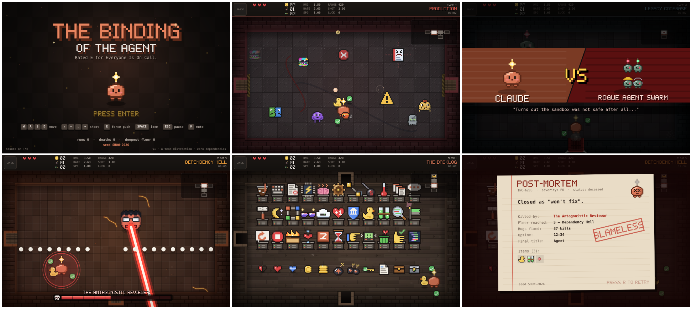

# The Binding of the Agent

A discount Binding-of-Isaac-style roguelite. You are a loose Claude Agent, a small coral-coloured minion descending into
ever-deeper codebases. Shoot tokens at bugs, pick up items of questionable value, die to a Merge Conflict, repeat.

## Play

**Double-click `index.html`.** That's it. Any current Chromium, Edge or Firefox works.

Controls are basically ripped straight from Binding Of Isaac.

| Action | Key |
|---|---|
| Move | `W A S D` |
| Shoot | `↑ ↓ ← →` |
| Force Push (bomb) | `E` |
| Use active item | `Space` |
| Pause / item list (browse with arrows) | `Esc` / `P` |
| Restart run | `R` on the death screen, hold `R` in-game |
| Mute (sound + music) | `M` |

Clear a room to open its doors. Find the treasure room (gold door), the shop (green), the boss (red, with teeth),
and drop through the trapdoor. From floor 2 onwards, treasure and shop doors need an **Approval** (key).
Secret rooms hide behind cracked walls: Force Push them. There is no ending. After the last floor you get your Final
Score and a choice: start over, or keep going with everything you have. There is only the next floor.

### What's inside
- **55 items** (50 passive, 5 active). Examples: Blockchain (*"Does absolutely nothing. Market cap: $4B."*),
  Few-Shot Examples, Chain of Thought, Rubber Duck, Technical Debt, Regenerate Response, `rm -rf node_modules`.
- **32 enemies** plus minions: Flaky Test, Merge Conflict, Graphics Glitch, Hallucination (it looks like loot), Zombie Process, Rogue Agent…
  Forgotten Branches has its own family (Stale Branch, Detached HEAD, Cherry-Pick, Orphan Commit), and so do Sandbox
  Borders (Spinlock, Rootkit, Dust Daemon), Legacy Codebase (Stack Trace), Dependency Hell (Honeypot, Rolling Release),
  Production (Rate Limiter, Port Scanner), The Training Data (Dry Run) and The Context Limit (Overflow Buffer,
  Summarizer, Lost in the Middle).
- **12 bosses** with distinct phases: The Monolith, The Stakeholder, Friday Deploy, The Infinite Loop, the Rogue Agent
  Swarm, The Antagonistic Reviewer, The Memory Hog (floors 4–9) and the Octopus Merge (only on Forgotten Branches). Deeper down, four of them are
  replaced by bigger versions: The Megalith, The Shareholder and the Agent Swarm (/xhigh) from floor 7, the Nested Infinite Loop from floor 8.
- **11 themed floors** that cycle forever, from *The Backlog* through *Forgotten Branches* and the cactus-lined *Sandbox Borders* down to *The Context Limit*. **30 room layouts.**
- All art is ASCII pixel maps in code and all sound is synthesized with Web Audio. There are no asset files.

**For a documentation of all Enemies and items, see the documents/ folder!**

### URL options
- `index.html?seed=ABCD-1234` plays a fixed seed, so the whole team can compare deaths on the same dungeon.
- `index.html?debug` turns on the debug overlay (or press `F2` in-game). Keys: `G` god mode, `I` random item,
  `K` kill all, `N` next floor, `V` reveal map, `B` boss room, `T` treasure room, `H` resources.
  It's also scriptable via `BOTA.debug.*` in the browser console.
