# The Binding of the Agent: Enemies and bosses

All enemies, minions and bosses in the game.

## Reading the numbers

**Depth scaling.** Enemies and bosses get tougher on deeper floors: enemy HP +15 % per floor, boss HP +30 % per
floor. Their attacks also come a little faster and their shots fly a little quicker (up to 25 % shorter pauses).
The HP values below are floor-1 values.

**Damage.** Touching an enemy or getting hit by its shot costs half a heart; touching a boss costs a full heart.
For comparison, the player has 3 hearts at the start and moves at 240 px/s; enemy shots fly at 165–260 px/s.

---

## Enemies

HP is the floor-1 value. "First floor" is the earliest floor where an enemy can appear in normal rooms.
Some enemies belong to one floor theme and only appear there; floor themes repeat every 11 floors, so
"Forgotten Branches" means floors 3, 14, 25 and so on.

| | Name | First floor | HP | Behaviour | Flavour text |
|---|---|---|---|---|---|
| 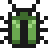 | **Bug** `bug` | 1 | 8 | Wanders around slowly. Gets rarer on deeper floors | It's not a bug, it's a feature. A feature with mandibles. |
|  | **Null Pointer** `null_pointer` | 1 | 5 | Flies straight at you, fast but fragile | Points at nothing. Charges at you anyway. |
|  | **Memory Leak** `memory_leak` | 1 | 14 | Chases you slowly and grows the longer it lives. Splits into 2 Leaklets when killed | Gets bigger the longer you ignore it. |
|  | **Hallucination** `hallucination` | 1 | 6 | Disguised as a Credit, Half Heart or Approval until you get within about 120 px or a bomb goes off nearby, then chases you fast. Real pickups of the same kinds lie around in some combat rooms too, so you can't tell them apart by looks. 10 % chance per combat room (+1 % per floor, max 25 %) to appear on top of the normal enemies (max 1); twice that on Sandbox Borders (mirages), still at most 25 % | Looked real. Was, in fact, not real. |
|  | **Flaky Test** `flaky_test` | 2 | 10 | Fades out and teleports 170–400 px away from you, then fires one aimed shot. Can't be hit while faded | Passes on my machine. |
|  | **Merge Conflict** `merge_conflict` | 2 | 18 | When lined up with you horizontally or vertically, winds up for 0.5 s and dashes. Max 3 per room | <<<<<<< HEAD |
|  | **Jira Ticket** `jira_ticket` | 2 | 18 | Stationary turret: a 4-way burst every 1.7 s, alternating + and × directions. Max 2 per room | Priority: Blocker. Assignee: you. |
| 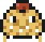 | **Spaghetti Code** `spaghetti_code` | 2 | 14 | Wanders and fires a 3-shot spread every 2.5 s | Nobody knows where it starts. Or ends. |
| 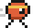 | **Race Condition** `race_condition` | 2 | 6 | Always comes in pairs; zigzags erratically and sometimes sprints. Max 4 per room | Sometimes it hits first. Sometimes you do. Sometimes both. |
|  | **Graphics Glitch** `graphics_glitch` | 2 | 10 | Flickers in place, then jumps 1–3 tiles in a straight line (a faint copy shows where it will land). Usually jumps toward you. When it touches you, it scrambles one part of the top bar for 7 s: hearts, active item, stats or minimap. Max 2 per room | Is it supposed to look like this...? |
|  | **Deprecation Warning** `deprecation_warning` | 3 | 12 | Flies in circles around you at a distance (160–220 px) and fires an aimed shot every 2.4 s. Max 3 per room. 2.5× as common on Sandbox Borders | Will be removed in a future release. Not this one. |
| 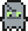 | **Zombie Process** `zombie_process` | 3 | 14 | Chases you. When killed, it lies down for 1.8 s and gets back up once with half its HP, angrier | `kill -9` recommended. |
|  | **Scope Creep** `scope_creep` | 4 | 10 | Slowly grows (up to 1.9× size and 1.6× HP). Once big enough, fires a ring of shots every 3.6 s. Max 2 per room | Just one more small feature. |

### Forgotten Branches family

These only appear on Forgotten Branches floors. They share a woody look with leaf colours, rustle and knock
instead of clicking when hit, and shed leaves when they take damage.

| | Name | First floor | HP | Behaviour | Flavour text |
|---|---|---|---|---|---|
|  | **Stale Branch** `stale_branch` | 3 (Forgotten Branches only) | 12 | A twig creature whose leaves go green → yellow → brown → bare over about 15 s while a "-N commits behind" counter above it counts up. Starts slow (60 px/s) and speeds up to 150 px/s. Once bare it says "STALE" and every 2–3 s shudders for 0.5 s (a coral line shows the direction), then lunges at you for a full heart. Kill it early. Max 3 per room | This branch is 47 commits behind main. And counting. |
| 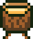 | **Detached HEAD** `detached_head` | 3 (Forgotten Branches only) | 12 + 6 | A stump on twig legs walks toward you; its head, a floating wooden tag with one eye, orbits behind it on a dashed tether and fires a slow amber shot every 2.2 s (its eye glows first). Kill the body first and the head panics ("HEAD detached!"), flying erratically and shooting more often. Kill the head first and the body wanders aimlessly ("where is my HEAD?"), only hurting on contact. Max 2 per room | You are in 'detached HEAD' state. The body did not get the memo. |
|  | **Cherry-Pick** `cherry_pick` | 3 (Forgotten Branches only) | 7 each | Always a pair joined by a stem (at most 140 px long), hopping around you. Hit one and the *other* gets angry for 3 s: darker, faster hops straight at you, and it spits a pit after puffing its cheeks. Kill one and the other stays angry for good. Max 4 per room | Hand-picked from another branch. Comes as a pair; hurt one and the other takes it personally. |
|  | **Orphan Commit** `orphan_commit` | 3 (Forgotten Branches only) | 6 | Harmless: never attacks and doesn't keep the doors shut. Runs away from you and hides in corners, trailing a faint dashed line. Catch it (touch it) or shoot it for 2–3 Credits. After 12 s the garbage collector takes it: it blinks and fades for the last 3 s, then vanishes without loot. 12 % chance per combat room (+1 % per floor) to appear on top of the normal enemies (max 1) | Unreachable from any branch. Catch it before the garbage collector does. |

### Sandbox Borders family

These only appear on Sandbox Borders floors. Dark bodies with light sand patterns (so they stand out on the sand),
sand bursts and dry crunching sounds when hit.

| | Name | First floor | HP | Behaviour | Flavour text |
|---|---|---|---|---|---|
| 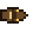 | **Spinlock** `spinlock` | 6 (Sandbox Borders only) | 16 | A desert snake coiled into a spinning ring that slowly creeps closer ("busy wait"). Its body blocks your shots; only the head can be hurt as it spins past. Then the rattle sounds, the head turns toward you and a dashed line shows its path, and it lunges along that line for a full heart. Afterwards it lies stretched out for a moment (head exposed) and coils up again. Max 2 per room | Busy-waits in a circle until you are close enough. Then it stops waiting. |
|  | **Rootkit** `rootkit` | 6 (Sandbox Borders only) | 12 | Travels under the sand (a moving mound, even under rocks) and can't be hurt there. Surfaces near you after a warning (the mound shakes, a target ring and "!" appear), popping out with a ring of 8 shots; stays up and hittable for 1.6 s, then dives again. A bomb near the mound flushes it out, stunned for 2 s and without the ring. Max 2 per room | Lives below the surface. Has root. Comes up only to ruin your day. |

### Minions

These are only spawned by other enemies or bosses.

| | Name | Spawned by | HP | Behaviour | Flavour text |
|---|---|---|---|---|---|
|  | **Leaklet** `leaklet` | Memory Leak (on death) | 4 | Chases you | A smaller leak. Still not freed. |
|  | **Spinlock body** `spinlock_segment` | Spinlock (4 per snake) | — | Part of the snake; blocks shots and hurts on contact; the last one is the rattle. Falls apart when the head dies | Part of the lock. Not the part you want to hit. |
|  | **Arm segment** `octo_arm` | Octopus Merge (8 arms of 5) | — | Part of an arm; only the tip (a commit dot) is visible and fires. Damage goes to the knot's HP at 60 %. Doesn't count for clearing the room | One of eight branches. Soon to be one of seven. |
|  | **Detached HEAD (head)** `detached_head_tag` | Detached HEAD (spawns with it) | 6 | Orbits the body and shoots; panics when the body dies (see above) | Points at a commit. Any commit. Just not yours. |
| 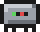 | **Microservice** `microservice` | The Monolith (phase 2) | 7 | Chases you | One of 47. Nobody knows which one is failing. |
|  | **Loop segment** `loop_segment` | The Infinite Loop | — | Body segment of the worm; fires outward. Damage goes to the head's HP. Doesn't count for clearing the room | while (true) { suffer(); } |

---

## Bosses

One boss per floor, in the room farthest from the start. **Floor 1:** The Monolith (60 %) or The Stakeholder (40 %).
**Floor 2:** Monolith, Infinite Loop and Rogue Agent Swarm 27 % each, Stakeholder 18 %. **Floor 3** (Forgotten
Branches): its own boss, the Octopus Merge, at about 52 %; Monolith, Infinite Loop and Rogue Agent Swarm 13 % each,
Stakeholder 9 %. **Floor 4 and deeper:** Friday Deploy and the Antagonistic Reviewer join: 18 % each, Stakeholder 12 %.
On later Forgotten Branches floors (14, 25, …) the Octopus Merge comes back at about 41 %, the other six 10 % each and
the Stakeholder 7 %. These are the base odds.
Within a run, the boss of the previous floor never comes again right away, and every boss you've already met counts
only 1/(1 + times met) as much, so a run sees more different bosses. Every attack has a
visible warning before it fires (glow, "!", target ring). Beating a boss drops an item, a heart and the trapdoor
to the next floor.

| | Name | First floor | HP | Attacks | Phase 2 | Intro subtitle |
|---|---|---|---|---|---|---|
| 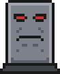 | **The Monolith** `monolith` | 1 | 360 | Lumbers toward you. **Stomp:** a ring of 12 shots. **Batch job:** 3 aimed 5-shot fans in a row | Below 50 % HP: splits off Microservice minions, walks faster, stomps twice, fires 4 offset 6-shot fans and adds a **leap** at your position | *Single point of failure since 1998.* |
|  | **The Stakeholder** `stakeholder` | 1 | 250 | Floats and keeps its distance. **Requirements:** rotating 2-arm spiral for 3 s. **Urgent request:** 3 aimed 5-shot fans | Below 40 % HP ("ACTUALLY…"): clears all shots, then 3-arm spirals that switch direction, 4 wider 7-shot fans, and a **scope change** ring whose shots stop and then re-aim at you. Pacing eased on 2026-10-31 | *Just a quick question.* |
|  | **Friday Deploy** `friday_deploy` | 4 | 240 | A burning server rack bouncing around the room like a DVD logo. Every wall hit vents a 5-shot fire fan; a corner hit fires a 16-shot ring. Regularly **rolls back** to the centre with a hotfix ring | Below 50 % HP: faster and hotter (7-shot fans) | *What could go wrong at 16:55?* |
| 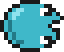 | **The Infinite Loop** `infinite_loop` | 2 | 300 | A worm made of ∞ segments. The head circles the room on an ellipse and sometimes hunts you; the segments fire pulses outward. All damage goes to one shared HP pool | Below 50 % HP: the head traces a figure eight instead | *while (true) { suffer(); }* |
| 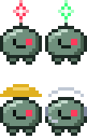 | **Rogue Agent Swarm** `rogue_swarm` | 2 | 4 × 80 | Four rogue copies of the player (red star, green star, hard hat, headset) circling in formation, one shared health bar. With all four alive they're slow and each fires a single aimed shot now and then (each shot is preceded by a green glow). Every agent that falls leaves a ghost for 1 s with a parting line ("Freeing compute..."), then the survivors heal 10 % of their max HP and get faster: 3 left fire 3-shot fans, 2 left fire 8-shot rings | The last one ("Last agent standing"): clears all shots, then alternates a dash at you (dashed aim line and target ring first) with a 2-arm spiral. Tip: spread your damage and finish them close together | *Turns out the sandbox was not safe after all...* |
|  | **The Antagonistic Reviewer** `reviewer` | 4 | 340 | A floating face behind mirrored glasses; slow and methodical. **Laser:** a thin red line follows you for 1 s, freezes and blinks for 0.4 s, then a wide beam fires from its mouth. **Nitpicks:** a slow row of comment bubbles crosses the room with one gap. **REJECTED:** a target ring appears under you and a stamp slams down after 1 s | Below 50 % HP ("Did you even proof-read ANY of this?!"): turns red, clears all shots, the laser sweeps about 20° toward you while firing, two rows of nitpicks, three stamps in a row | *This does, in fact, NOT look good to me.* |
| 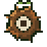 | **Octopus Merge** `octopus_merge` | 3 (Forgotten Branches only) | 330 | A knot of roots (the merge commit) with 8 woody arms that end in commit dots. **Sweep:** a coral fan shows where an arm will swing, then it sweeps through it. **Slam:** a dashed line and a target ring mark the spot, then the arm slams down there. The tips glow, then fire aimed amber shots. Hitting an arm counts 60 % toward the knot. Every 12 % of HP lost, one arm **merges** into the knot ("Merged!") and the rest get 10 % faster | Below 50 % HP ("CONFLICT"): `<<<<<<<` and `>>>>>>>` markers appear on the walls, two attacks can run at once, slams add a ring of shots, and the knot glows and then fires two opposing streams that rotate slowly | *Eight branches. One merge commit. Zero survivors.* |
