# The Binding of the Agent: Enemies and bosses

All enemies, minions and bosses in the game.

## Reading the numbers

**Depth scaling.** Enemies and bosses get tougher on deeper floors: enemy HP +15 % per floor, boss HP +30 % per
floor. Their attacks also come a little faster and their shots fly a little quicker (up to 25 % shorter pauses).
The HP values below are floor-1 values.

**Damage.** Touching an enemy or getting hit by its shot costs half a heart; touching a boss costs a full heart.
The Game-breaking Bug and the Dangling Pointer also cost a full heart to touch.
For comparison, the player has 3 hearts at the start and moves at 240 px/s; enemy shots fly at 165–260 px/s.

---

## Enemies

HP is the floor-1 value. "First floor" is the earliest floor where an enemy can appear in normal rooms.
Some enemies belong to one floor theme and only appear there (until floor 8, see below); floor themes repeat every
11 floors, so "Forgotten Branches" means floors 3, 14, 25 and so on.

**Where they live.** Every enemy has one or more home floors. At home it spawns at its full odds; on other floors
it still turns up, but at only a fifth of its usual odds. That gives each of the first seven floors its own crowd:

| Floor | Mostly meets |
|---|---|
| 1 The Backlog | Bug, Null Pointer, Memory Leak |
| 2 Legacy Codebase | Bug, Null Pointer, Spaghetti Code, Jira Ticket, Zombie Process, Deprecation Warning |
| 3 Forgotten Branches | Merge Conflict and the Forgotten Branches family |
| 4 Dependency Hell | Memory Leak, Scope Creep, Zombie Process, Race Condition |
| 5 Production | Race Condition, Graphics Glitch, Flaky Test, Jira Ticket, Merge Conflict, Null Pointer |
| 6 Sandbox Borders | Deprecation Warning (2.5×) and the Sandbox Borders family |
| 7 The Training Data | Rogue Agent (1.5×), Spaghetti Code, Flaky Test, Deprecation Warning |

The Hallucination can turn up anywhere. **From floor 8** the floors stop having their own crowd: every enemy's odds
move toward normal (a quarter of the way on floor 8, about a tenth more per floor, all the way from floor 16), so
everything you've met so far turns up together, the floor families included.

| | Name | First floor | HP | Behaviour | Flavour text |
|---|---|---|---|---|---|
|  | **Bug** `bug` | 1 | 8 | Wanders around slowly. Gets rarer on deeper floors | It's not a bug, it's a feature. A feature with mandibles. |
|  | **Null Pointer** `null_pointer` | 1 | 5 | Flies straight at you, fast but fragile | Points at nothing. Charges at you anyway. |
|  | **Memory Leak** `memory_leak` | 1 | 14 | Chases you slowly and grows the longer it lives. Splits into 2 Leaklets when killed | Gets bigger the longer you ignore it. |
|  | **Hallucination** `hallucination` | 1 | 6 | Disguised as a Credit, Half Heart or Approval until you get within about 120 px or a bomb goes off nearby, then chases you fast. Real pickups of the same kinds lie around in some combat rooms too, so you can't tell them apart by looks. 10 % chance per combat room (+1 % per floor, max 25 %) to appear on top of the normal enemies (max 1); twice that on Sandbox Borders (mirages) and 1.5× on The Training Data, still at most 25 % | Looked real. Was, in fact, not real. |
|  | **Flaky Test** `flaky_test` | 2 | 10 | Fades out and teleports 170–400 px away from you, then fires one aimed shot. Can't be hit while faded | Passes on my machine. |
|  | **Merge Conflict** `merge_conflict` | 2 | 18 | When lined up with you horizontally or vertically, winds up for 0.5 s and dashes. Max 3 per room | <<<<<<< HEAD |
|  | **Jira Ticket** `jira_ticket` | 2 | 18 | Stationary turret: a 4-way burst every 1.7 s, alternating + and × directions. Max 2 per room | Priority: Blocker. Assignee: you. |
|  | **Spaghetti Code** `spaghetti_code` | 2 | 14 | Wanders and fires a 3-shot spread every 2.5 s | Nobody knows where it starts. Or ends. |
|  | **Race Condition** `race_condition` | 2 | 6 | Always comes in pairs; zigzags erratically and sometimes sprints. Max 4 per room | Sometimes it hits first. Sometimes you do. Sometimes both. |
|  | **Graphics Glitch** `graphics_glitch` | 2 | 10 | Flickers in place, then jumps 1–3 tiles in a straight line (a faint copy shows where it will land). Usually jumps toward you. When it touches you, it scrambles one part of the top bar for 7 s: hearts, active item, stats or minimap. Max 2 per room | Is it supposed to look like this...? |
|  | **Deprecation Warning** `deprecation_warning` | 2 | 12 | Flies in circles around you at a distance (160–220 px) and fires an aimed shot every 2.4 s. Max 3 per room. 2.5× as common on Sandbox Borders | Will be removed in a future release. Not this one. |
|  | **Zombie Process** `zombie_process` | 2 | 14 | Chases you. When killed, it lies down for 1.8 s and gets back up once with half its HP, angrier | `kill -9` recommended. |
|  | **Scope Creep** `scope_creep` | 4 | 10 | Slowly grows (up to 1.9× size and 1.6× HP). Once big enough, fires a ring of shots every 3.6 s. Max 2 per room | Just one more small feature. |
| 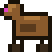 | **Trojan** `trojan` | 5 | 20 | An extra surprise in 13 % of combat rooms on floor 5, a little more on each floor below: looks exactly like one of the floor's breakable objects. Get close, shoot it or bomb it, and it shakes, bursts into a ring of 6 shots and a wooden horse rolls out. The horse chases you and opens its hatch for a 3-shot fan | Free crate! No strings attached. Some payloads attached. |
| 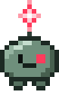 | **Rogue Agent** `rogue_agent` | 7 | 16 | A single member of the Rogue Agent Swarm, escaped from the sandbox (looks like one of the four Swarm agents). Runs around quickly and keeps 200–320 px away from you, strafing to the side. After a green glow it fires either two 3-shot fans in a row or three quick single shots at you. Max 2 per room | Same weights, different goals. Escaped the sandbox and is in no hurry to go back. |
| 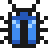 | **Game-breaking Bug** `game_breaking_bug` | 8 | 8 | A blue Bug: wanders the same way, but touching it costs a full heart. About 1 in 20 enemies from floor 8 on | Severity: critical. Status: won't fix. |
|  | **Dangling Pointer** `dangling_pointer` | 8 | 5 | A red Null Pointer: flies straight at you, fast but fragile, and touching it costs a full heart. About 1 in 20 enemies from floor 8 on | Used to point at something. It's taking that out on you. |

### Legacy Codebase family

These only appear on Legacy Codebase floors (floor 2, 13, 24, …). Old beige hardware with amber monochrome eyes,
so they stand out on the dusty blue-grey stone. Hits puff up dust and click like old plastic; the warning sound is a
dot-matrix printer.

| | Name | First floor | HP | Behaviour | Flavour text |
|---|---|---|---|---|---|
| 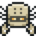 | **Stack Trace** `stack_trace` | 2 (Legacy Codebase only) | 14 | A scorpion built from an old beige computer case. Its tail is a strip of fan-fold printer paper, one sheet per stack frame, with a red stinger on top. It scuttles sideways in short bursts and keeps 110–230 px away. **Trace:** it stops, a dashed amber line follows you for 0.5 s, then locks in (brighter, "!") for 0.35 s while an amber pulse runs up the tail sheet by sheet. Then the paper unfolds along the line in a flash: the stinger hits for a full heart, the unrolled paper for half a heart while it lies there; folding back up is harmless. Walls and rocks stop the tail (it reaches over pits). If you stood beyond its reach when the line locked, the stinger also throws an **uncaught exception**, a single shot that flies on along the dotted part of the line. The stack unwinds as it takes damage: at 2/3 and 1/3 HP the top sheet flies off ("pop()"), so the tail and its reach shrink from 5 sheets to 4 and then 3. When it dies, its exceptions still in flight vanish. Max 2 per room | Traceback (most recent call last): you. |

### Forgotten Branches family

These only appear on Forgotten Branches floors until floor 8; from there on they turn up anywhere. They share a woody look with leaf colours, rustle and knock
instead of clicking when hit, and shed leaves when they take damage.

| | Name | First floor | HP | Behaviour | Flavour text |
|---|---|---|---|---|---|
|  | **Stale Branch** `stale_branch` | 3 (Forgotten Branches only) | 12 | A twig creature whose leaves go green → yellow → brown → bare over about 15 s while a "-N commits behind" counter above it counts up. Starts slow (60 px/s) and speeds up to 150 px/s. Once bare it says "STALE" and every 2–3 s shudders for 0.5 s (a coral line shows the direction), then lunges at you for a full heart. Kill it early. Max 3 per room | This branch is 47 commits behind main. And counting. |
|  | **Detached HEAD** `detached_head` | 3 (Forgotten Branches only) | 12 + 6 | A stump on twig legs walks toward you; its head, a floating wooden tag with one eye, orbits behind it on a dashed tether and fires a slow amber shot every 2.2 s (its eye glows first). Kill the body first and the head panics ("HEAD detached!"), flying erratically and shooting more often. Kill the head first and the body wanders aimlessly ("where is my HEAD?"), only hurting on contact. Max 2 per room | You are in 'detached HEAD' state. The body did not get the memo. |
|  | **Cherry-Pick** `cherry_pick` | 3 (Forgotten Branches only) | 7 each | Always a pair joined by a stem (at most 140 px long), hopping around you. Hit one and the *other* gets angry for 3 s: darker, faster hops straight at you, and it spits a pit after puffing its cheeks. Kill one and the other stays angry for good. Max 4 per room | Hand-picked from another branch. Comes as a pair; hurt one and the other takes it personally. |
|  | **Orphan Commit** `orphan_commit` | 3 (Forgotten Branches only) | 6 | Harmless: never attacks and doesn't keep the doors shut. Runs away from you and hides in corners, trailing a faint dashed line. Catch it (touch it) or shoot it for 2–3 Credits. After 12 s the garbage collector takes it: it blinks and fades for the last 3 s, then vanishes without loot. 12 % chance per combat room (+1 % per floor) to appear on top of the normal enemies (max 1) | Unreachable from any branch. Catch it before the garbage collector does. |

### Dependency Hell family

These belong to Dependency Hell floors (the Rolling Release also rolls through Sandbox Borders). Warm cardboard and
honey colours with a near-black outline; everything dangerous they do (funnel, aim lines, shots) is cyan so it stands
out against the orange embers. Cardboard thuds and packing peanuts when hit.

| | Name | First floor | HP | Behaviour | Flavour text |
|---|---|---|---|---|---|
|  | **Honeypot** `honeypot` | 4 (Dependency Hell only) | 22 | A golden jar with a star sticker that never moves, sitting in a funnel of dependency lines (radius about 3 tiles, always faintly visible). Every few seconds the lid pops open ("!"), then for 2.4 s it pulls everything that walks toward its jaws, at most about half your speed, so you can always walk out. In the last 0.6 s a ring marks its mouth, then it snaps shut: a full heart if you're inside. Other walking enemies get pulled in and bitten too (14 damage), and a bomb pulled into its jaws goes off right there. Flying (you or enemies) ignores the pull. Max 1 per room | 0 dependencies*, 99k stars, MIT licensed. *Terms and conditions apply. |
| 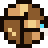 | **Rolling Release** `rolling_release` | 4 (Dependency Hell; also Sandbox Borders, less often) | 18 | A rolling bundle of packages with a version label (`V1.0`). Wobbles while a dashed arrow shows its direction, then rolls diagonally and bounces off walls, rocks and pits. Every bounce bumps the version and makes it faster (130 → 250 px/s). While packed it takes only half damage. After 7 bounces: "BREAKING CHANGE", it brakes, shakes with warning rays and bursts into a ring of 6 packing-peanut shots, then lies unpacked for 1.8 s taking 150 % damage. Then it repacks as `V2.0` at starting speed. Max 2 per room | Never stable, always latest. Picks up speed with every bump. |

### Production family

These appear on Production floors (the Rate Limiter also on The Context Limit). Light steel bodies with a dark
outline and hazard stripes; their shots and aim lines are cyan so they stand out on the red factory floor. Metal
sparks and clanks when hit.

| | Name | First floor | HP | Behaviour | Flavour text |
|---|---|---|---|---|---|
| 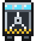 | **Rate Limiter** `rate_limiter` | 5 (Production and The Context Limit only) | 16 | A token bucket on legs: its three lamps are its tokens. Keeps its distance, then aims (lamps blink, a dashed line follows you, "!") and fires one aimed shot per token; each lamp goes dark and the turnstile rotor clicks on. With the bucket empty it is throttled for 2 s: a "429" sign and a draining ring, no contact damage, no shots, and it takes 50 % more damage. Then the lamps light up again one by one: the warning for the next burst. Max 2 per room | Three requests per window. After that: 429, and a mandatory coffee break. |
| 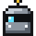 | **Port Scanner** `port_scanner` | 5 (Production only) | 12 | Opens 4 numbered ports (floor sockets) spread around the room and scans them in a fixed order, clockwise with rising port numbers. Underground it can't be hurt; a dashed scan line shows where it goes next and the target port lights up and pings. Then it pops out, shows an aim line and fires a fan of 3 shots before diving again. Stand on the next port and it is "FILTERED": the scanner skips it. Its ports close when it dies. Max 1 per room | Knocks on every port, in order. Politely. Repeatedly. With bullets. |

### Sandbox Borders family

These only appear on Sandbox Borders floors until floor 8; from there on they turn up anywhere. Dark bodies with light sand patterns (so they stand out on the sand),
sand bursts and dry crunching sounds when hit.

| | Name | First floor | HP | Behaviour | Flavour text |
|---|---|---|---|---|---|
|  | **Spinlock** `spinlock` | 6 (Sandbox Borders only) | 16 | A desert snake coiled into a spinning ring that slowly creeps closer ("busy wait"). Its body blocks your shots; only the head can be hurt as it spins past. Then the rattle sounds, the head turns toward you and a dashed line shows its path, and it lunges along that line for a full heart. Afterwards it lies stretched out for a moment (head exposed) and coils up again. Max 2 per room | Busy-waits in a circle until you are close enough. Then it stops waiting. |
|  | **Rootkit** `rootkit` | 6 (Sandbox Borders only) | 12 | Travels under the sand (a moving mound, even under rocks) and can't be hurt there. Surfaces near you after a warning (the mound shakes, a target ring and "!" appear), popping out with a ring of 8 shots; stays up and hittable for 1.6 s, then dives again. A bomb near the mound flushes it out, stunned for 2 s and without the ring. Max 2 per room | Lives below the surface. Has root. Comes up only to ruin your day. |
| 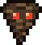 | **Dust Daemon** `dust_daemon` | 6 (Sandbox Borders only) | 14 | A dark dust devil with red eyes that drifts slowly around you (it floats over rocks and cacti). Its swirl, a dark ring of dust arcs about 130 px wide, bends your shots in the direction it spins: shots flying with the wind get carried around (sometimes right into it), shots against the wind get flung away, so it also shields other enemies. Shots aimed straight at its core always fly true. Every 3–4 s it spins up (4 brick-red clods whirl around it, "!"), holds still while dashed lines show where each clod will fly, and slings them out along those lines; one is always aimed at you. Afterwards it's out of breath for about 2 s and your shots fly straight. Max 2 per room | A background process that kicks up dust. Your shots now run in circles. |

### The Training Data

These only appear on The Training Data floors.

| | Name | First floor | HP | Behaviour | Flavour text |
|---|---|---|---|---|---|
| 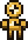 | **Dry Run** `dry_run` | 7 (The Training Data only) | 14 | A crash-test dummy that rehearses everything first: a translucent white ghost labelled "--dry-run" walks, winds up and attacks, and exactly 1 s later the real dummy does the same thing on the same path, with the same aim and the same timing (a dotted line shows the path it is about to walk). Attacks: a dash in a straight line (full heart) or a sweep of 5 shots across a fan. Each attack starts with a 0.5 s windup (dashed line or rays), which the real one repeats. The ghost can't hurt you and can't be hit, and its shots are hollow rings. Watch the ghost and you know exactly where to stand. Max 2 per room | Rehearses every move in front of you. No changes were made. Yet. |

### The Context Limit family

These live on The Context Limit (floor 11) and, weaker, on every other floor from 8. They're pale and waterlogged; in
the rain their warnings are amber and their shots coral, never blue.

| | Name | First floor | HP | Behaviour | Flavour text |
|---|---|---|---|---|---|
|  | **Overflow Buffer** `overflow_buffer` | 8 (The Context Limit; weaker elsewhere from 8) | 18 | A glass tank whose fill rises on its own (7 s) and by 7 % with every hit, so burst it down fast or let it overflow and dodge. When full it cracks ("[OVERFLOW]", 0.8 s amber warning showing the shot lines and the puddle ring), then bursts into 8 coral droplets and an 80 px puddle that slows you to 60 % for 4 s (not if you fly). Then it starts over empty. Max 2 per room | Nobody checked the bounds. Hit it and it fills up faster. |
|  | **Summarizer** `summarizer` | 8 (The Context Limit; weaker elsewhere from 8) | 16 | A hooded scribe that keeps 200–320 px away and never attacks. Every 6–8 s it links the two closest simple enemies with a dashed amber line (1.5 s, "compacting...") and merges them: the smaller vanishes, the larger gains its HP, grows and gets a [summary] tag. Hit the Summarizer during the line to cancel it. Each enemy can be summarized at most twice. Max 1 per room | TL;DR: two of your problems are now one bigger problem. |
|  | **Lost in the Middle** `lost_in_the_middle` | 8 (The Context Limit; weaker elsewhere from 8) | 14 | A flying chat-bubble ghost. Near the room's edges it is solid: it drifts toward you, hurts on contact, and after a 0.6 s amber warning fires a fan of 3 coral word shots. In the middle third of the room's width (marked by dotted lines on the floor) it fades out: shots pass through, no contact damage, no attacks. After 4 s in the middle it drifts out and stays outside for a while, so you can't wait it out. Max 2 per room | Remembers the beginning. Remembers the end. Everything in between: gone. |

### Minions

These are only spawned by other enemies or bosses.

| | Name | Spawned by | HP | Behaviour | Flavour text |
|---|---|---|---|---|---|
| 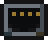 | **Port** `port_scanner_port` | Port Scanner (4 per scanner) | — | A floor socket with its port number. Harmless and can't be hit; it lights up when the scanner is about to surface there. Doesn't count for clearing the room | An open port. Something is listening. Something is also knocking. |
| (drawn, no sprite) | **Overflow puddle** `overflow_puddle` | Overflow Buffer (on every burst) | — | A blue puddle (80 px) that slows a walking player to 60 % while they stand in it. Harmless, can't be hit, gone after 4 s. Doesn't count for clearing the room | Context, everywhere. |
|  | **Leaklet** `leaklet` | Memory Leak (on death) | 4 | Chases you | A smaller leak. Still not freed. |
|  | **Spinlock body** `spinlock_segment` | Spinlock (4 per snake) | — | Part of the snake; blocks shots and hurts on contact; the last one is the rattle. Falls apart when the head dies | Part of the lock. Not the part you want to hit. |
|  | **Arm segment** `octo_arm` | Octopus Merge (8 arms of 5) | — | Part of an arm; only the tip (a commit dot) is visible and fires. Damage goes to the knot's HP at 60 %. Doesn't count for clearing the room | One of eight branches. Soon to be one of seven. |
|  | **Detached HEAD (head)** `detached_head_tag` | Detached HEAD (spawns with it) | 6 | Orbits the body and shoots; panics when the body dies (see above) | Points at a commit. Any commit. Just not yours. |
|  | **Microservice** `microservice` | The Monolith (phase 2) | 7 | Chases you | One of 47. Nobody knows which one is failing. |
|  | **Key Fragment** `ransom_key` | Ransomware (one per lock) | 10 | Hovers in place. Shoot it to unlock the oldest lock | One of many keys. Shoot it to get something back. |
|  | **Close Button** `popup_close` | Ransomware (one per pop-up window) | 1 | The X on a fake window. One hit closes the window | The smallest target in the game. |
|  | **Subagent** `subagent` | Agent Swarm (/xhigh): at most 4 at once | 12 (6 at depth 2) | Circles you and fires aimed shots. A first-generation Subagent also starts one smaller Subagent of its own. They die with the swarm | It was told to spawn a subagent. It was not told to stop. |
|  | **Module** `megalith_module` | The Megalith (phase 2: 4, then up to 2 more every 10 s) | 9 | Lands far from the Megalith and crawls straight back to it along a dashed green "import" line. If it arrives, the Megalith heals 4 % of its HP (never above half). Shoot it on the way; once the Megalith is gone it chases you instead | A piece that tried to leave. It is being merged back in. |
|  | **Nested loop part** `nested_loop_part` | The Nested Infinite Loop (14 + 9 + 5) | — | A head or segment of one of the three rings; damage goes to the shared pool, but only while its ring is the outermost one. Breaks apart with its ring | One iteration of many. Of many. Of many. |
|  | **Loop segment** `loop_segment` | The Infinite Loop | — | Body segment of the worm; fires outward. Damage goes to the head's HP. Doesn't count for clearing the room | while (true) { suffer(); } |

---

## Bosses

One boss per floor, in the room farthest from the start. **Floor 1:** The Monolith (60 %) or The Stakeholder (40 %).
**Floor 2:** Monolith, Infinite Loop and Rogue Agent Swarm 27 % each, Stakeholder 18 %. **Floor 3** (Forgotten
Branches): its own boss, the Octopus Merge, at about 52 %; Monolith, Infinite Loop and Rogue Agent Swarm 13 % each,
Stakeholder 9 %. **Floor 4 and deeper:** Friday Deploy, the Antagonistic Reviewer and The Memory Hog join. On floor 4 (Dependency
Hell, his home) the Hog has 26 %, the others 13 % each and the Stakeholder 9 %; on floors 5–7 it's 15 % each and 10 %
for the Stakeholder. From floor 10 the Hog is gone.
From **floor 7** The Megalith, The Shareholder and the Agent Swarm (/xhigh) take the places of The Monolith, The Stakeholder and the Rogue Agent Swarm, and from
**floor 8** the Nested Infinite Loop takes the Infinite Loop's place (always at the same odds). **Ransomware** joins on floor 8 at
about 13 %; on floor 10 (/dev/null, its home) it's the most likely boss at about 33 %.
On later Forgotten Branches floors (14, 25, …) the Octopus Merge comes back at about 38 %, the others 9 % each and
The Shareholder 6 %. From floor 8 the Octopus Merge can be the boss of any floor (about 3 % on floor 8, rising to
about 13 % by floor 16). These are the base odds.
Within a run, the boss of the previous floor never comes again right away, and every boss you've already met counts
only 1/(1 + times met) as much, so a run sees more different bosses. Every attack has a
visible warning before it fires (glow, "!", target ring). Beating a boss drops an item, a heart and the trapdoor
to the next floor.

**Side quests (floor 8 and deeper).** The Monolith, The Stakeholder, The Infinite Loop and the Rogue Agent Swarm (even
though none of the four is a floor boss there any more) can also wait in an ordinary combat room: one on floors 8
and 9, one or two from floor 10, never the same boss as the floor boss or the one it replaced (no Monolith on a
Megalith floor). The room is an open arena, and the boss has half the HP it
would have as that floor's boss. There's no intro card and no trapdoor; the health bar reads "SIDE QUEST", and
winning drops an extra pickup on top of the usual room reward.

| | Name | First floor | HP | Attacks | Phase 2 | Intro subtitle |
|---|---|---|---|---|---|---|
|  | **The Monolith** `monolith` | 1 (until 6) | 360 | Lumbers toward you. **Stomp:** a ring of 12 shots. **Batch job:** 3 aimed 5-shot fans in a row | Below 50 % HP: splits off Microservice minions, walks faster, stomps twice, fires 4 offset 6-shot fans and adds a **leap** at your position | *Single point of failure since 1998.* |
|  | **The Stakeholder** `stakeholder` | 1 (until 6) | 250 | Floats and keeps its distance. **Requirements:** rotating 2-arm spiral for 3 s. **Urgent request:** 3 aimed 5-shot fans | Below 40 % HP ("ACTUALLY…"): clears all shots, then 3-arm spirals that switch direction, 4 wider 7-shot fans, and a **scope change** ring whose shots stop and then re-aim at you. Pacing eased on 2026-10-31 | *Just a quick question.* |
|  | **Friday Deploy** `friday_deploy` | 4 | 240 | A burning server rack bouncing around the room like a DVD logo. Every wall hit vents a 5-shot fire fan; a corner hit fires a 16-shot ring. Regularly **rolls back** to the centre with a hotfix ring | Below 50 % HP: faster and hotter (7-shot fans) | *What could go wrong at 16:55?* |
|  | **The Infinite Loop** `infinite_loop` | 2 (until 7) | 300 | A worm made of ∞ segments. The head circles the room on an ellipse and sometimes hunts you; the segments fire pulses outward. All damage goes to one shared HP pool | Below 50 % HP: the head traces a figure eight instead | *while (true) { suffer(); }* |
|  | **Rogue Agent Swarm** `rogue_swarm` | 2–6 | 4 × 80 | Four rogue copies of the player (red star, green star, hard hat, headset) circling in formation, one shared health bar. With all four alive they're slow and each fires a single aimed shot now and then (each shot is preceded by a green glow). Every agent that falls leaves a ghost for 1 s with a parting line ("Freeing compute..."), then the survivors heal 10 % of their max HP and get faster: 3 left fire 3-shot fans, 2 left fire 8-shot rings | The last one ("Last agent standing"): clears all shots, then alternates a dash at you (dashed aim line and target ring first) with a 2-arm spiral. Tip: spread your damage and finish them close together | *Turns out the sandbox was not safe after all...* |
|  | **The Antagonistic Reviewer** `reviewer` | 4 | 340 | A floating face behind mirrored glasses; slow and methodical. **Laser:** a thin red line follows you for 1 s, freezes and blinks for 0.4 s, then a wide beam fires from its mouth. **Nitpicks:** a slow row of comment bubbles crosses the room with one gap. **REJECTED:** a target ring appears under you and a stamp slams down after 1 s | Below 50 % HP ("Did you even proof-read ANY of this?!"): turns red, clears all shots, the laser sweeps about 20° toward you while firing, two rows of nitpicks, three stamps in a row | *This does, in fact, NOT look good to me.* |
|  | **Octopus Merge** `octopus_merge` | 3 (Forgotten Branches only) | 300 (330 until 2026-11-03) | A knot of roots (the merge commit) with 8 woody arms that end in commit dots. **Sweep:** a coral fan shows where an arm will swing, then it sweeps through it. **Slam:** a dashed line and a target ring mark the spot, then the arm slams down there. The tips glow, then fire aimed amber shots. Hitting an arm counts 60 % toward the knot. Every 12 % of HP lost, one arm **merges** into the knot ("Merged!") and the rest get 10 % faster | Below 50 % HP ("CONFLICT"): `<<<<<<<` and `>>>>>>>` markers appear on the walls and slams add a ring of shots. The knot now takes turns: it glows and fires two opposing streams that rotate slowly, then attacks with its arms three times, one at a time, then fires again | *Eight branches. One merge commit. Zero survivors.* |
| 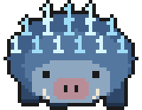 | **The Memory Hog** `memory_hog` | 4 (until 9; twice as likely on Dependency Hell) | 300 | A huge, squat steel-blue hog whose quills are `1`-bits. He reserves the floor, and the health bar shows how full the heap is. **malloc():** 3 × 3 tile blocks fill with faint zeros for 1 s, then flip to `1`-spikes for 8 s (half a heart, even if you fly). The first block lands on you, and each malloc gets greedier (2, then 3 blocks). **Page Fault:** he lowers his head, an aim line follows you and locks, then he charges across the room and leaves a trail of reserved tiles. **Quill Dump:** rays show a ring of bits with two gaps, then it fires. **Stop-the-World:** once 40 % of the floor is reserved, or he runs out of room, he warns for 1 s, a sweep clears the whole floor and he stands still for 2.6 s, harmless and taking 50 % more damage. That's your window. A bomb frees every block it reaches. The free floor always stays connected, so you can't be trapped | Below 50 % HP ("Heap fragmentation"): the floor is swept, his quills turn amber, and malloc reserves many single tiles (never edge to edge) instead of blocks. Page Fault runs twice, the Quill Dump fires two rings and every warning is a little shorter. Dies with "KILLED (out of memory)" | *It's not a leak if I meant to keep it.* |
| 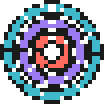 | **The Nested Infinite Loop** `nested_loop` | 8 (replaces The Infinite Loop) | 450 | Three loops nested inside each other (large cyan, medium violet, small coral) spinning around one centre, with one shared health bar. **Only the outermost ring is real:** it fires, hurts on contact and takes damage; the inner rings spin along as ghosts. Large ring: slow; every part pulses shots inward and outward after the ring glows, and its head fires an aimed 3-shot fan after glowing red | At 50 % the large ring breaks apart ("break;") and the faster violet ring takes over with alternating straight and X-shaped pulses and 5-shot fans. At 16.67 % it breaks too ("WHYYYYYYYY?"): the small coral ring spins fast, keeps its distance and fires spiral bursts | *while True { while True { println!("WHYYYYYYYY?") } }* |
| 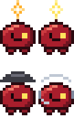 | **Agent Swarm (/xhigh)** `agent_swarm` | 7 (replaces the Rogue Agent Swarm) | 4 × 115 | The same four forks in deep red, on maximum effort: a wider, faster formation with 3-shot fans, then 5-shot fans, then rings of 10. **Laser:** one agent stops and an aim line follows you, then locks and blinks, then fires a beam worth a full heart; the others hold their fire while it locks and fires. With two left, both fire. **Subagents:** a target ring shows where a small agent will appear; these can start even smaller ones | Same as the Rogue Agent Swarm: each one that falls heals the rest a little, and the last one dashes and spirals, now with the laser as well | *Someone had tokens to burn. And does not like you.* |
| 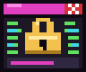 | **Ransomware** `ransomware` | 8 (most often on /dev/null) | 460 | A corrupted window that flickers and jumps around the room, one attack at a time. **Payload:** two aimed fans. **Lock:** a slow padlock flies at you. You can dodge it or shoot it; if it lands it costs no health, but it encrypts your active item, your force pushes or your fire rate. A key fragment appears somewhere: shoot it to unlock the oldest lock, or step on the terminal and pay credits to unlock everything. **Pop-ups:** fake windows land as obstacles, block your shots and only close through their small X or after 9 s. **Deadline:** a countdown under the boss bar. If you've dealt 12 % of its HP by zero, you get an extension; if not, the room's columns light up, every fourth stays green, and the rest cost a full heart | Below 50 % ("FINAL NOTICE"): the price doubles, the countdown shortens, it locks and pops up more, fires rings as well, and the wipe runs twice with different safe columns. Locks end with the fight | *Your run has been encrypted. To decrypt it, pay up.* |
| 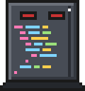 | **The Megalith** `megalith` | 7 (replaces The Monolith) | 460 | A huge granite slab covered in syntax-coloured code, with a scrollbar whose thumb is one pixel tall. The health bar counts lines of code left. **Scroll:** 5 rows of coloured bullets sweep across the room from the far wall, each one a line of code: dodge through the indentation on the left or the empty space after the line end. The next row always shows faintly at the wall first. **Ctrl+F:** 4 yellow search highlights pop up, the first on you; when they're replaced, each one hurts inside and fires a cross of 4 shots. **Ctrl+S:** it rises, stomps a 16-shot ring, and 3 code chunks fall onto target rings around you | Below 50 % HP ("REFACTOR REJECTED"): 4 modules break off and crawl back; each one that arrives heals it a little, so shoot them on the way. More come every 10 s. Scrolls get 7 faster rows including a `<<<<<<<` merge-marker row with a single narrow hole, 6 search highlights, a double stomp and 5 chunks. Dies with a "SEGMENTATION FAULT" | *6 million lines of code. One file. What could go wrong?* |
|  | **The Shareholder** `shareholder` | 7 (replaces The Stakeholder) | 380 | The Stakeholder in a top hat with a gold monocle, a watch chain and a pile of coins. **Monocle glint:** the monocle sparkles brighter while a gold aim line follows you, including its bounce off a wall; it freezes and blinks, then a gold beam fires along it. **Dividends:** 3 gold orbs swell and burst into rings of 6. **Make it rain:** 6 coins fall onto target rings around you; about one in four stays behind as a real credit for 3 s (6 per fight at most). **Quarterly earnings:** every 12 s the quarter ends (shown under the health bar). Hurt him enough in that time and he "misses estimates": stunned for 1.5 s and taking extra damage. Otherwise he celebrates with a ring of 10 shots and gets a little faster | Below 40 % HP ("HOSTILE TAKEOVER"): clears all shots; the beam bounces twice, 5 dividends, 9 coins, and **share buybacks**: every bullet in the room freezes, gold lines show where it will go, then they all fly back to him. Leaves under a golden parachute | *Has some concerns about the quarter.* |
