# The Binding of the Agent: Floors and themes

All floor themes in the game, what each one looks and sounds like, and what (if anything) changes in gameplay.

## How floors work

**Cycle.** There are 11 floor themes. Floor *n* uses theme *(n − 1) mod 11*, so the list repeats forever: floor 12 is
The Backlog again, floor 14 is Forgotten Branches again, and so on. Repeated floors get a roman numeral on the floor
card ("The Backlog II").

**Depth vs. theme.** Difficulty follows the **depth** (floor number), never the theme: enemy unlocks, room budgets, HP
scaling and boss pools all go by depth. The theme decides the look, the music, the breakable objects, which enemies
are common there, and a few theme-specific extras (marked *Gameplay* below).

**Who lives where.** On floors 1–7 every enemy has one or more home floors. At home it spawns at full odds;
elsewhere it still turns up, but at only a fifth of its usual odds. Each floor's residents are listed under
*Gameplay, enemies* below. The floor families (Legacy Codebase, Forgotten Branches, Dependency Hell, Production, Sandbox Borders, The
Training Data) live only on their own floor until floor 8.

**Floor 8 and deeper: everything at once.** From floor 8 the floor identity fades. The odds of every enemy that is
rare or absent on a floor are raised toward normal (a quarter of the way on floor 8, about a tenth more per floor,
completely from floor 16). The floor families now turn up on every floor, more and more often, and the Octopus Merge
can be the floor boss anywhere (at most as likely as a regular boss). The home floors still get their bonus (for example
Deprecation Warnings on Sandbox Borders). Some combat rooms on these floors also hold a **side quest**: one of the early
bosses (The Monolith, The Stakeholder, The Infinite Loop or the Rogue Agent Swarm) at half the floor boss's HP, in an
open arena, without the intro card or the trapdoor. There's one on floors 8 and 9 and one or two from floor 10.
By then the floor bosses have grown up: from floor 7 The Megalith and The Shareholder replace The Monolith and The
Stakeholder, and from floor 8 the Nested Infinite Loop replaces the Infinite Loop (a side quest is never the floor
boss or the one it replaced).

**What a theme controls** (`B.FLOOR_THEMES` in `src/data/palette.js`, names in `B.TEXT.FLOORS` in `src/data/text.js`):
- **Colours:** floor checkerboard, walls, doors, an accent colour (floor card, HUD floor name, minimap frame), a soft
  light in the room centre and the vignette tint.
- **Floor pattern** and **decor** (background details baked into the room), optionally **wall decor** and an animated
  **ambient** layer.
- **Breakable objects:** which kinds appear, in how many combat rooms, and how many per room.
- **Music:** root note, scale, tempo and lead instrument of the procedural chiptune loop.
- **Tile sprites (optional):** a theme can swap the look of rocks, blocks or spikes (`tiles`); Sandbox Borders uses
  this for sandstone boulders and border fences.
- *Gameplay (optional):* map shape (`gen`), cacti (`cacti`), themed enemies and bosses (`themes` / `themeOnly`),
  extra quips and epitaphs.

Things that look **the same on every floor**: pits and spikes, doors and the special rooms (treasure, shop, boss,
secret); rocks and blocks too, except on Sandbox Borders.

---

## Overview

| | # | Floor | Pattern | Decor | Breakables | Music | Extras |
|---|---|---|---|---|---|---|---|
| 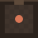 | 1 | **The Backlog** `backlog` | Wooden planks | Sticky notes and paper scraps | Crates | D dorian, 104 bpm, square | — |
| 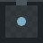 | 2 | **Legacy Codebase** `legacy` | Irregular stone slabs | Cobwebs in corners | Crates | A minor, 92 bpm, triangle | — |
| 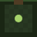 | 3 | **Forgotten Branches** `branches` | Moss, soil and grass | Roots drawn like a `git log --graph` | Bushes | G dorian, 98 bpm, triangle, bird calls | Ivy, fireflies, branchier maps, own enemy family and boss |
| 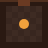 | 4 | **Dependency Hell** `dephell` | Square tiles | Glowing cracks and embers | Packages, cartons | B phrygian, 128 bpm, sawtooth | — |
| 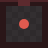 | 5 | **Production** `production` | Checker plate with rivets | Hazard stripes at doors, cables | Packages, cartons | A harmonic minor, 138 bpm, square | Own enemy family |
|  | 6 | **Sandbox Borders** `sandbox` | Rippled sand | Bleached bones, pebbles, dry grass | Sandcastles | D phrygian, 100 bpm, triangle | Cacti (solid, prick), border fences, sandstone, tumbleweeds, own enemy family |
| 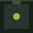 | 7 | **The Training Data** `training` | Graph paper | Scattered characters (`0 1 {} lol tl;dr nan`) | Cartons, crates | E major, 116 bpm, triangle | — |
|  | 8 | **The Latent Space** `latent` | Dot grid | Stars and a constellation | Bushes, packages | C lydian, 96 bpm, sine | — |
|  | 9 | **Undefined Behavior** `undefined` | Square tiles | Shifted colour stripes (glitches) | All four kinds | B♭ locrian, 144 bpm, square | — |
| 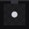 | 10 | **/dev/null** `devnull` | Dot grid | Almost nothing: a few lost bits | Crates, packages | G minor, 80 bpm, triangle | — |
|  | 11 | **The Context Limit** `context` | Square tiles, wet | Fading fragments of earlier context, puddles, water streaks | Crates, packages, cartons | C♯ minor, 84 bpm, sine | Downpour, whispers, distant lightning, own family, Rate Limiters |

The swatch is a tiny room in the theme's colours: wall, floor checkerboard, door (top) and accent (centre dot).

### Colour coverage

Almost all floors are **dark**: the floors sit at low brightness so that sprites, pickups and enemy shots stand out.
Sandbox Borders is the one mid-bright floor; its sand is muted on purpose so yellow and amber shots stay readable. By hue:

- **Browns / warm:** The Backlog (brown), Dependency Hell (rust with orange embers), Production (grey with red walls).
- **Sand / yellow:** Sandbox Borders (dusky sand, sun-yellow accent).
- **Greens:** Forgotten Branches (forest green), The Training Data (muted green).
- **Blues / violets:** Legacy Codebase (blue-grey), The Latent Space (indigo), The Context Limit (pale fog blue).
- **Other:** Undefined Behavior (magenta-purple), /dev/null (near black).

**Gaps:** nothing cyan or teal, and nothing truly bright (white, snow, light stone). Several enemies fire yellow or
amber shots, so check contrast with screenshots before settling on a bright palette.

---

## The floors

### 1. The Backlog

*Where tickets go to die.*

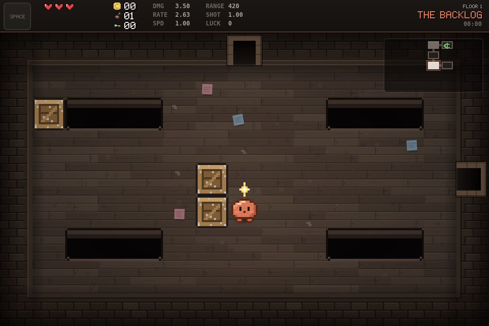

- **Look:** warm cardboard brown; horizontal wooden planks with staggered joints; forgotten sticky notes (yellow, pink,
  blue, green) and paper scraps on the floor. Accent: coral `#d97757` (the avatar's colour).
- **Breakables:** crates in 60 % of combat rooms, up to 3 per room.
- **Music:** D dorian, 104 bpm, square lead.
- **Gameplay, enemies:** gentle on purpose: only Bugs, Null Pointers and Memory Leaks (plus the occasional
  Hallucination).

### 2. Legacy Codebase

*Written by someone who left in 2009.*

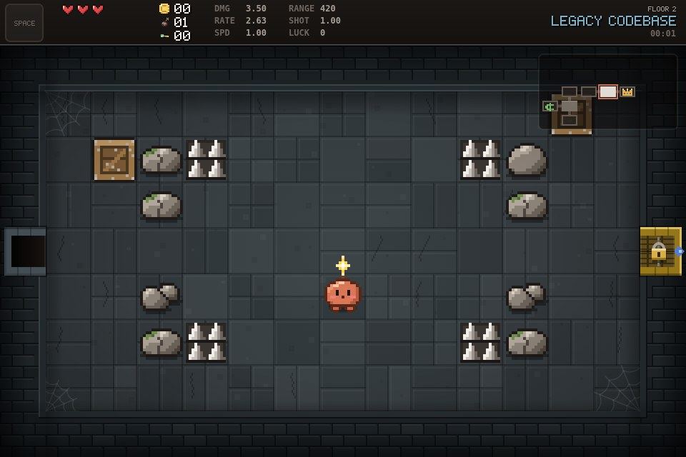

- **Look:** dusty blue-grey; old, irregular stone slabs (1, 2 or 4 per tile); cobwebs in the inner corners. Accent:
  steel blue `#7fb0c9`.
- **Breakables:** crates in 65 % of combat rooms, up to 3 per room.
- **Music:** A minor, 92 bpm, triangle lead.
- **Gameplay, enemies:** the old-code crowd: Bugs, Null Pointers, Spaghetti Code, Jira Tickets, Zombie Processes and
  Deprecation Warnings (the last two arrive here a floor earlier than they used to). Its own enemy is the Stack
  Trace, a beige computer-case scorpion whose printer-paper tail stings along a telegraphed line.

### 3. Forgotten Branches

*It is probably for the best that these never got merged.*

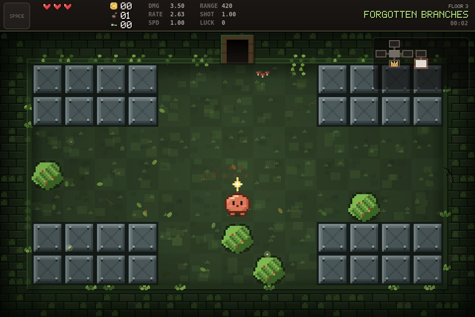

- **Look:** forest floor of moss cushions, soil patches and grass blades instead of joints. Roots on the floor are a
  little `git log --graph`: a trunk with commit dots and one or two branches that split off and never merge back. Ivy
  hangs from the walls and fireflies drift through the room. Accent: leaf green `#a6d36b`.
- **Breakables:** bushes in 80 % of combat rooms, up to 4 per room.
- **Music:** G dorian, 98 bpm, triangle lead, with an occasional bird call (never during the boss fight).
- **Gameplay, maps:** branchier, with at least 7 dead ends per floor instead of 3 (`gen.minDeadEnds`).
- **Gameplay, enemies:** an own family found only here (until floor 8): Stale Branch, Detached HEAD, Cherry-Pick and
  the Orphan Commit (see the enemies list). They share a woody look, leaf effects and wood-knock sounds. Merge
  Conflicts are at home here too. Together they make up about three quarters of the enemies on floor 3.
- **Gameplay, boss:** the Octopus Merge, about 52 % on floor 3 and 41 % on floors 14, 25, … on a first visit.
- **Extra text:** room-clear quips ("Branch deleted", "Stale for 847 days", "Rebased onto nothing", …) and epitaphs
  ("Died on a branch nobody remembers.", …) mixed into the general lists.

### 4. Dependency Hell

*node_modules now has its own gravitational field.*

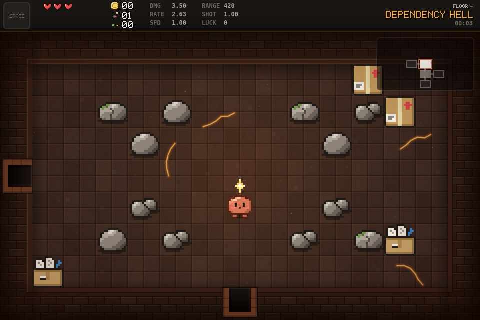

- **Look:** rusty dark brown; square tiles with bevelled edges; glowing cracks and ember dots. The strongest light of
  all floors (orange). Accent: amber `#f0a03c`.
- **Breakables:** packages and cartons in 70 % of combat rooms, up to 4 per room.
- **Music:** B phrygian, 128 bpm, sawtooth lead.
- **Gameplay, enemies:** things that multiply and won't stay dead: Memory Leaks, Scope Creep, Zombie Processes and
  Race Conditions. Its own family (cardboard bodies, cyan shots against the orange embers): the Honeypot, a jar whose
  funnel pulls you toward its jaws, and the Rolling Release, a bundle of packages that bounces faster with every
  bump until a "Breaking Change" bursts it open.

### 5. Production

*Don't touch anything. Especially on a Friday.*

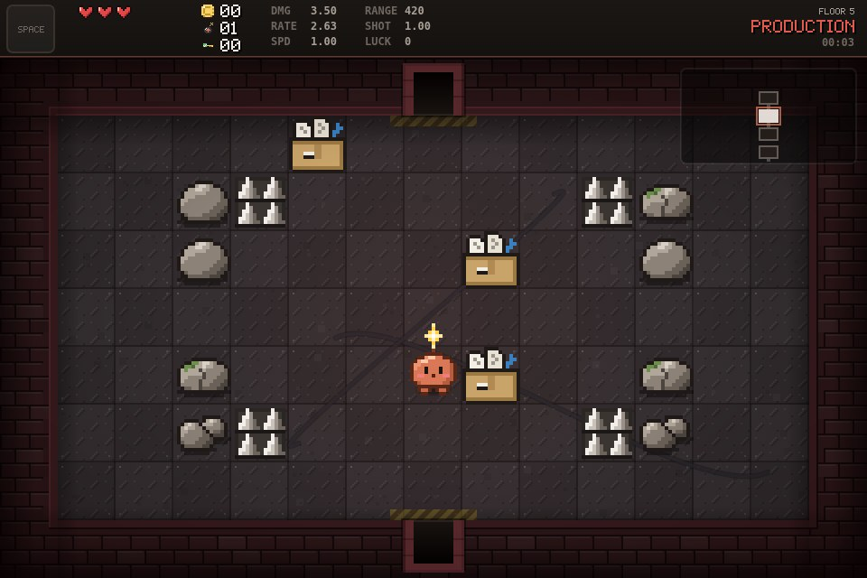

- **Look:** industrial grey checker plate with diagonal studs and riveted seams; dark red walls; yellow-black hazard
  stripes in front of the doors and cables across the floor. Accent: signal red `#e05a4f`.
- **Breakables:** packages and cartons in 70 % of combat rooms, up to 4 per room.
- **Music:** A harmonic minor, 138 bpm, square lead.
- **Gameplay, enemies:** everything that breaks at runtime: Race Conditions, Graphics Glitches, Flaky Tests, Jira
  Tickets, Merge Conflicts and Null Pointers. Its own family (since 2026-11-03): the Rate Limiter (fires three shots,
  then sits out a "429" pause; also on The Context Limit) and the Port Scanner (pops out of numbered floor ports in a
  fixed order). Steel bodies, cyan shots: red would vanish on this floor.

### 6. Sandbox Borders

*Nobody mentioned the cacti. Or the lack of water.*

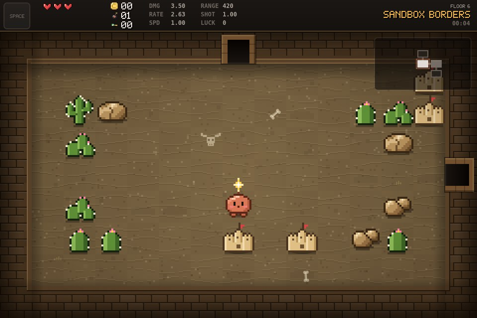

- **Look:** the edge of the sandbox: dusky, rippled sand (muted, so yellow and amber shots stay readable),
  sandstone walls, bleached bones in the sand (horned skulls, ribcages, single bones), pebbles and dry grass. Now and
  then a tumbleweed rolls across the room. Accent: sun yellow `#f2b84b`.
- **Obstacles:** rocks become sandstone boulders, and indestructible blocks become the border itself: chain-link
  fences with barbed wire where blocks line up, striped concrete barriers where they stand alone.
- **Gameplay, cacti:** half of the rocks in combat rooms are cacti instead. They are solid like rocks but prick you
  on contact (half a heart and a push back); bombs blow them up. Never right in front of a door.
- **Gameplay, enemies:** an own family found only here (until floor 8), the Spinlock (a coiled desert snake that
  lunges) and the Rootkit (burrows under the sand and pops up next to you). Deprecation Warnings live here too and
  are 2.5× as common, and Hallucinations twice as likely (mirages). Since 2026-11-03 the family also has the Dust
  Daemon (a whirlwind that bends your shots), and the Rolling Release from Dependency Hell tumbles through as a
  tumbleweed (at 0.6× its usual odds).
- **Breakables:** sandcastles in 75 % of combat rooms, up to 4 per room; when damaged, a tower collapses.
- **Music:** D phrygian, 100 bpm, triangle lead.
- **Extra text:** room-clear quips ("Permission denied", "Sandbox violation logged", "No water found", …) and
  epitaphs ("Escaped the sandbox. Not the cactus.", …).

### 7. The Training Data

*It's mostly forum arguments.*

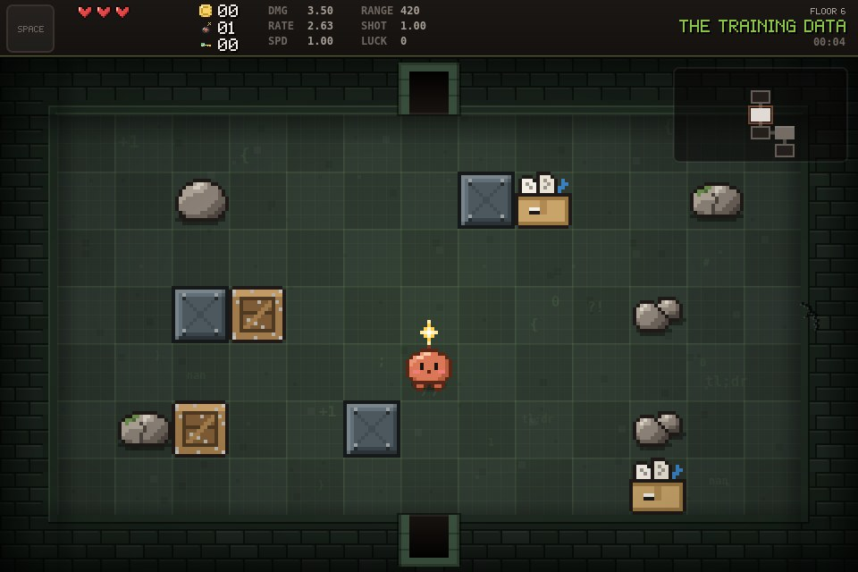

- **Look:** muted green graph paper (fine lines every 16 px, stronger every 64 px); scattered characters from the
  "training data": `0`, `1`, `{`, `}`, `;`, `+1`, `lol`, `?!`, `tl;dr`, `nan`, … Accent: lime `#8bc34a`.
- **Breakables:** cartons and crates in 70 % of combat rooms, up to 4 per room.
- **Music:** E major, 116 bpm, triangle lead.
- **Gameplay, enemies:** what the model learned from: Rogue Agents (they debut here and are 1.5× as common),
  Spaghetti Code, Flaky Tests and Deprecation Warnings (outdated docs). Hallucinations are 1.5× as likely. Its own
  enemy is the Dry Run: a ghost rehearses every move, and the crash-test dummy repeats it exactly one second later.

### 8. The Latent Space

*Here be embeddings.*

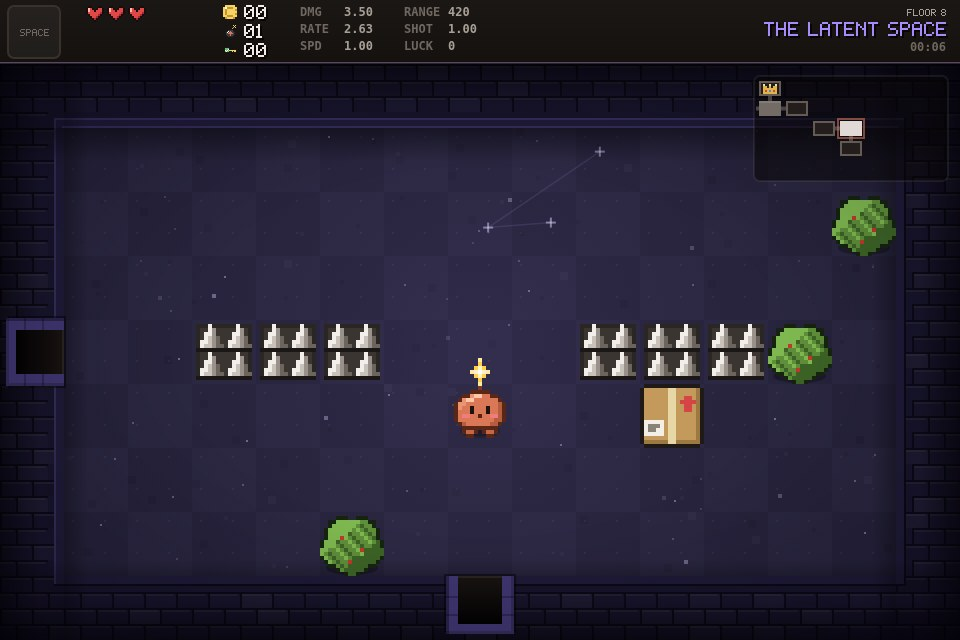

- **Look:** deep indigo with a dot grid; stars (embeddings) and one constellation per room. Accent: lavender
  `#a78bfa`.
- **Breakables:** bushes and packages in 75 % of combat rooms, up to 4 per room.
- **Music:** C lydian, 96 bpm, sine lead.
- **Gameplay:** the first floor where everything mixes (see "Floor 8 and deeper" above), and the first side quest.

### 9. Undefined Behavior

*Anything can happen. Mostly bad things.*

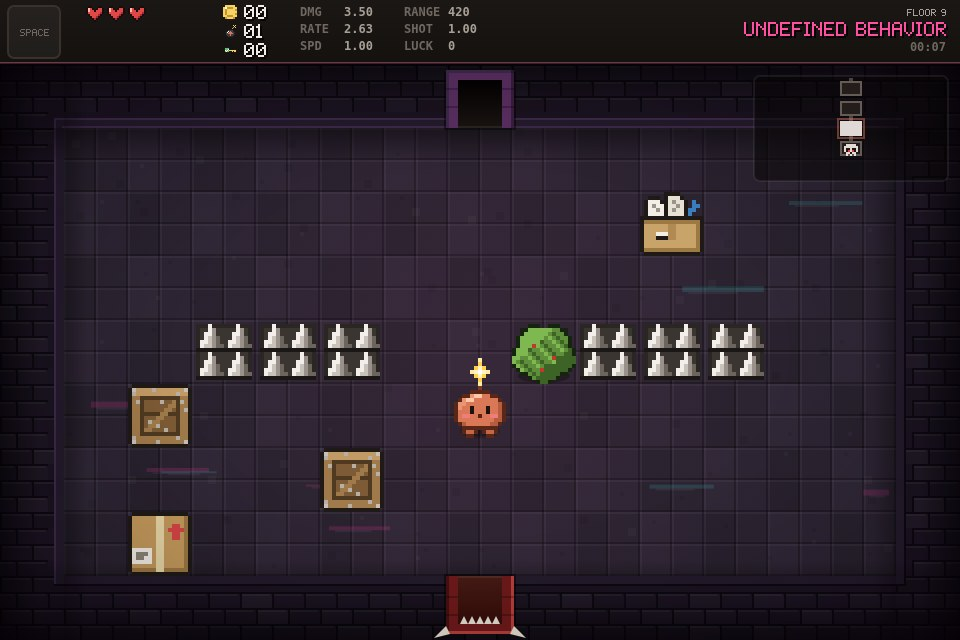

- **Look:** dark purple tiles with shifted magenta and turquoise stripes, like rendering glitches. Accent: hot pink
  `#ff4fa3`.
- **Breakables:** all four kinds (crates, bushes, packages, cartons) in 80 % of combat rooms, up to 5 per room.
- **Music:** B♭ locrian, 144 bpm, square lead (the fastest loop).

### 10. /dev/null

*Everything you send here is gone. Including you.*

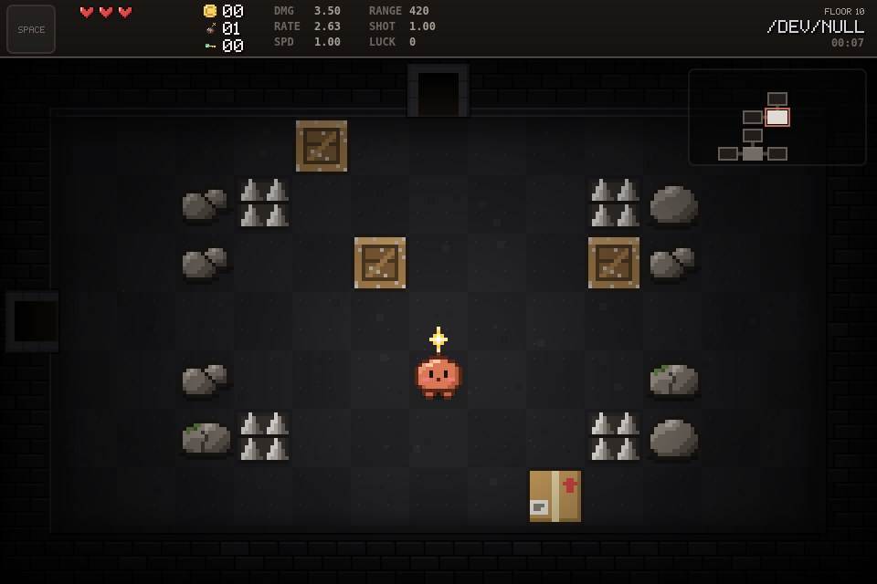

- **Look:** almost black and monochrome; a faint dot grid and almost nothing else, just a few lost bits. Accent:
  pale grey `#d0d0d8`.
- **Breakables:** crates and packages in 75 % of combat rooms, up to 5 per room.
- **Music:** G minor, 80 bpm, triangle lead (the slowest loop).

### 11. The Context Limit

*You've been here before. You don't remember.*

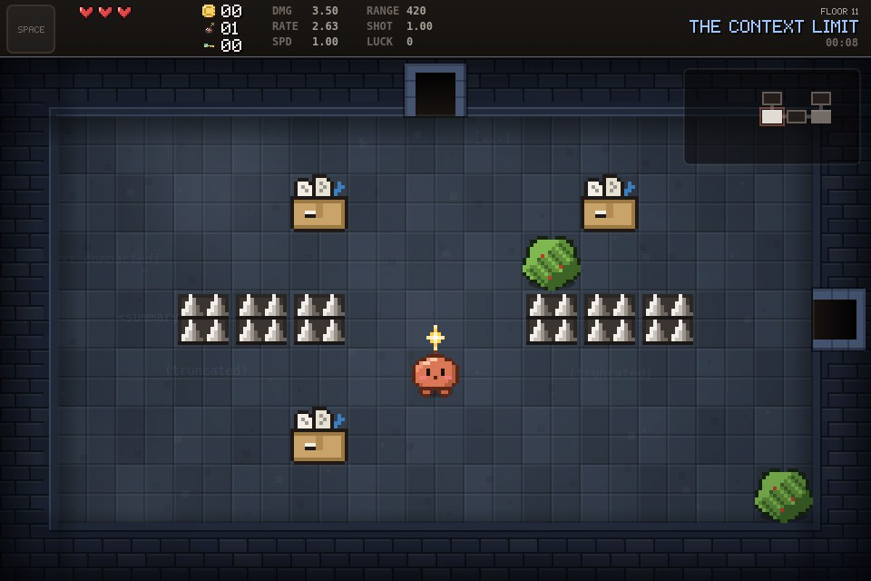

- **Look:** pale fog blue tiles with soft fog patches; faint, half-faded fragments of earlier context on the floor
  ("[...]", "(truncated)", "as I said earlier", "[context compacted]", …). Accent: light blue `#9ec5ff`.
- **Weather** (since 2026-11-03): it's always raining here. Two layers of slanted rain fall over the room under a cold
  grey wash, drops ring out on the floor (mostly in the dark puddles), and water runs down the walls. Every 25–55 s a
  very soft flash of distant lightning is followed by a low rumble, and a quiet rain sound plays under the music.
- **Whispers:** every 4–9 s one of the floor's fragments flickers into view somewhere in the room, types itself out,
  loses its letters one by one (truncated context) and fades away, with a whisper you can barely hear. Purely
  cosmetic: it never touches the run's random numbers, so seeds stay the same.
- **Gameplay, enemies:** its own family (2026-11-03): the **Overflow Buffer** (a glass tank that fills up and bursts
  into droplets and a slowing puddle), the **Summarizer** (merges two enemies into one bigger one unless you
  interrupt it) and **Lost in the Middle** (a ghost you can only hit near the room's edges). The Rate Limiter from
  Production also lives here (a floor about tokens and limits).
- **Breakables:** crates, packages and cartons in 80 % of combat rooms, up to 5 per room (no bushes since 2026-11-03:
  they fit the theme but clashed with the rain and puddles).
- **Music:** C♯ minor, 84 bpm, soft sine lead (was C♯ mixolydian, 108 bpm, square until 2026-11-03).

---

## Adding a floor

The step-by-step recipe is in AGENTS.md (§5, "Add a floor"). In short: add an entry at the same position in
`B.TEXT.FLOORS` and `B.FLOOR_THEMES`; new patterns, decor, wall decor or ambient layers need a case in
`src/render/renderer.js`. Inserting a floor in the middle shifts every later floor down by one and changes the cycle
length, so themed content (like Forgotten Branches) repeats on different floor numbers afterwards. Then run
`node tools/export-floors.js` and add the new floor to this document.
