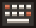
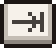
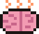
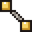
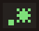
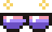
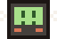
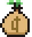
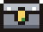
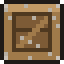

# The Binding of the Agent: Items and pickups

All items and pickups in the game.

## Reading the numbers

**Player base stats.** Item effects are added to these first, then multipliers (×) are applied:

| Stat | Base | Notes |
|---|---|---|
| Damage | 3.5 | per shot |
| Fire delay | 0.38 s | time between shots, about 2.6 shots/s (shown as RATE in the HUD); lower is better |
| Speed | 1.0 | 1.0 = 240 px/s |
| Shot speed | 1.0 | 1.0 = 480 px/s |
| Range | 420 px | |
| Shot size | 1.0 | 1.0 = 9 px radius |
| Luck | 0 | more room-clear drops and better chances at rare pickups |
| Health | 3 hearts | max 12 hearts in total, red and blue (guardrail) combined |

**Where items appear** (the "Found in" column): **Treasure** room, **Shop** (for the listed price),
**Boss** reward, **Secret** room. Each item appears at most once per run until every item has been seen.

---

## Items

### Stat items

| | Name | Effect | Found in | Price | Flavour text |
|---|---|---|---|---|---|
|  | **Cold Brew** `cold_brew` | Speed +0.25 | Treasure, Shop, Boss | 12¢ | Caffeine: the original agentic framework. |
|  | **Mechanical Keyboard** `mech_keyboard` | Fire delay −0.06 s | Treasure, Shop, Boss | 15¢ | Clack clack clack. Your open-plan office has filed a complaint. |
|  | **Stack Overflow Printout** `stack_overflow` | Damage +1 | Treasure, Shop, Boss | 15¢ | Marked as duplicate. Worked anyway. |
|  | **Extended Context Window** `context_window` | Range +150, shot speed −0.1 | Treasure, Boss | — | Two million tokens of things you'll forget by the next room. |
|  | **Prompt Caching** `prompt_caching` | Fire delay ×0.75 (about +33 % fire rate) | Treasure, Shop | 18¢ | Same tokens, 90 % cheaper. You've basically printed money. |
|  | **Tab Completion** `tab_completion` | Fire delay −0.08 s, range −80 | Treasure, Shop, Boss | 15¢ | Accepts the first suggestion. Every time. Without reading. |
|  | **Max Effort** `max_effort` | Damage +1, speed −0.1 | Treasure, Boss | — | Reasoning effort: max. Everything takes longer, but hits harder. |
|  | **Monorepo** `monorepo` | Shot size +0.6, damage +0.5, shot speed −0.2 | Treasure, Boss | — | Everything in one giant blob. What could go wrong. |
|  | **Kubernetes** `kubernetes` | A little of everything: speed +0.08, damage +0.4, fire delay −0.02 s, shot speed +0.08, range +40, shot size +0.1, luck +1 | Treasure, Shop, Boss | 18¢ | Nobody knows what it does. Everyone agrees you need it. |
|  | **Blockchain** `blockchain` | Nothing at all (on purpose) | Shop, Secret | 20¢ | Disruptive. Decentralised. Does absolutely nothing. Market cap: $4B. |
|  | **Technical Debt** `technical_debt` | Damage ×1.6, but you lose one heart container (never below 1 heart) | Treasure, Secret | — | Ship now, pay later. With interest. Compounding. |
|  | **Off-by-One Error** `off_by_one` | Damage +0, +1 or +2, rolled once when picked up | Treasure, Secret | — | We counted from zero. Or did we. |
|  | **YAML Config** `yaml_config` | Every stat shifts randomly, slightly positive on average. The range per stat runs from −1 to +1.3 times its step: speed 0.15, damage 0.8, fire delay 0.05 s, shot speed 0.15, range 90, shot size 0.2, luck 2 | Treasure, Secret | — | Your stats are now whitespace-sensitive. |

### Shot modifiers

| | Name | Effect | Found in | Price | Flavour text |
|---|---|---|---|---|---|
|  | **Temperature 1.5** `temperature` | Damage +1.5; shots wobble from side to side | Treasure, Secret | — | More creative. Less correct. Like your commit messages. |
|  | **Few-Shot Examples** `few_shot` | Fires 3 shots in a fan; fire delay ×1.35 | Treasure, Boss | — | Three examples. Same mistake, three times. |
|  | **Regex** `regex` | Fires 2 parallel shots. With Few-Shot Examples you get the 3-shot fan instead | Treasure, Shop | 15¢ | You solved it with a regex. Now you have two shots and two problems. |
|  | **Chain of Thought** `chain_of_thought` | Piercing: shots pass through enemies | Treasure | — | Let's think step by step. Through the enemy. And the one behind it. |
|  | **Confident Hallucination** `confident_hallucination` | Homing shots | Treasure, Secret | — | The target is wherever I say it is. |
|  | **Linter** `linter` | Shots bounce off walls (up to 3 times) | Treasure, Shop | 15¢ | Your shots bounce now. Also: 4,812 warnings. |
|  | **Dark Mode** `dark_mode` | Spectral: shots fly through rocks and blocks (not walls) | Treasure, Secret | — | Easier on the eyes. Harder on the enemies. |
|  | **Microservices** `microservices` | Shots split into 4 smaller shots (half damage) on impact | Treasure | — | You had one problem. Now it's distributed across four services. |
|  | **Vibe Coding** `vibe_coding` | Each shot gets random damage ×0.5 to ×2; size and colour vary with it | Treasure, Secret | — | Accept all. Don't read the diff. Feel the vibes. |
|  | **Ctrl+C Ctrl+V** `copy_paste` | Each shot has a 25 % chance to fire a copy at a slight angle | Treasure, Shop | 15¢ | Why write it twice when you can paste it four times? DRY is a suggestion. |
|  | **Feature Flag** `feature_flag` | In each new room, 50 % chance to be ON: damage +1.5 and fire delay ×0.9 (shots turn green). Always ON right after pickup | Treasure, Shop | 15¢ | Wrapped in a flag nobody owns. It's on in this room. Probably. Check the shot colour. |
|  | **Benchmark Overfitting** `benchmark_overfitting` | Damage ×0.9, but every hit on a boss deals +60 % bonus damage | Treasure, Boss | — | Scores 98 % on the boss benchmark. Struggles with literally everything else. |

### Health and protection

| | Name | Effect | Found in | Price | Flavour text |
|---|---|---|---|---|---|
|  | **RLHF** `rlhf` | +1 heart container and a full heal | Treasure, Shop, Boss | 15¢ | Fine-tuned to be more likable. Mostly by people paid per click. |
|  | **Constitutional Guardrails** `constitutional_guardrails` | +2 guardrail (blue) hearts | Treasure, Shop, Boss | 12¢ | Principles: has them, mentions them, often. |
|  | **Retry with Backoff** `retry_backoff` | Once per run, survive a lethal hit: come back with half your hearts (at least 1), 2 s invulnerable, enemies frozen for 1.5 s. Costs speed −0.1 for the rest of the run | Treasure, Secret | — | Failed? Try again. Slower. |
|  | **git blame** `git_blame` | Damage +2 while you have 1 heart or less left (red + blue) | Treasure, Secret | — | It was never your fault. The logs prove it. |
|  | **On-Call Pager** `on_call_pager` | When you get hit, enemies within 200 px take 10 damage and are pushed away | Treasure, Secret | — | Woken up at 3 a.m.? Then so is everyone within a 200 px radius. |
|  | **Garbage Collector** `garbage_collector` | Every 12 kills: heal half a heart (or +2¢ at full health) and freeze enemies for 0.6 s | Treasure, Boss | — | Every 12 kills it reclaims half a heart. Stop-the-world pauses included. |
|  | **The Cloud** `the_cloud` | Flight: fly over pits, rocks and spikes | Treasure, Secret | — | It's just someone else's computer. But it floats. |

### Utility, resources and followers

| | Name | Effect | Found in | Price | Flavour text |
|---|---|---|---|---|---|
|  | **Code Review** `code_review` | Shows enemy HP bars; luck +1 | Treasure, Shop | 10¢ | Now you can see exactly how bad things are. |
|  | **Daily Standup** `daily_standup` | Freezes all enemies for 2 s when you enter a room | Treasure, Shop | 15¢ | Everyone stops what they're doing for "15 minutes". |
|  | **LGTM** `lgtm` | +2 Approvals (keys) | Treasure, Shop | 10¢ | Didn't read it. Approved it. Twice. |
|  | **Seed Funding** `seed_funding` | +15 credits | Treasure, Boss, Secret | — | Pre-revenue. Pre-product. Pre-everything. Here, have some money. |
|  | **Rubber Duck** `rubber_duck` | A duck follows you and shoots along with you: ⅓ of your damage, about half your fire rate | Treasure, Shop | 15¢ | Never says anything. Still the best senior engineer on the team. |
|  | **Unit Tests** `unit_tests` | 2 orbiting shields that block enemy shots and deal 2 damage to enemies they touch | Treasure, Shop | 15¢ | They test nothing, but they're always around you. Coverage: 100 %. |

### Active items

Use with **Space**. Active items charge by one segment per cleared room and come fully charged when picked up.
You can carry one at a time; picking up another swaps them. If there's nothing to do (e.g. full health for
/compact), the charge is kept.

| | Name | Charge | Effect | Found in | Price | Flavour text |
|---|---|---|---|---|---|---|
|  | **Regenerate Response** `regenerate_response` | 2 | Rerolls every item pedestal in the room (shop prices update), or the pickups if there are no pedestals | Treasure, Shop | 15¢ | Same prompt. Different answer. Same disappointment. |
|  | **Stop Generating** `stop_generating` | 3 | Freezes all enemies for 4 s | Treasure, Shop | 15¢ | ■ Stop. Everyone stop. Thank you. |
|  | **rm -rf node_modules** `rm_rf` | 4 | 25 damage to every enemy in the room | Treasure, Shop, Boss | 18¢ | Freed 4.2 GB. Feels incredible. Nothing builds anymore. |
|  | **/compact** `compact` | 6 | Heals 2 hearts | Treasure, Shop | 15¢ | Forget everything except the important bits. You feel lighter. |
|  | **Ctrl+Z** `ctrl_z` | 3 | Restores your health and guardrails to what they were when you entered the room | Treasure, Shop, Secret | 15¢ | Restores your health to how it was when you entered the room. Unlike prod. |

---

## Pickups

Pickups come from room-clear rewards (35 % chance per cleared room, +3 % per luck), broken rocks (8 %), chests
and the shop. Enemies don't drop anything. In addition, 18 % of combat rooms already have 1–2 pickups lying on the
floor when you walk in (Credit 67 %, Half Heart 22 %, Approval 11 %). These are the same three kinds the
Hallucination disguises itself as, so a pickup in a room that's still fighting may or may not be real. "Drop share" is how often each type is picked when a random drop
happens (at luck 0). Luck raises the share of rare drops.

| | Name | ID | Effect | Drop share | Shop price |
|---|---|---|---|---|---|
|  | **Half Heart** | `heart_half` | Heals half a heart (not picked up at full health) | 12.5 % | — |
|  | **Heart** | `heart` | Heals 1 heart (not picked up at full health) | 8.0 % | 3¢ |
|  | **Guardrail** | `guardrail` | +1 blue heart (absorbs damage first) | 4.5 % | 6¢ |
|  | **Credit** | `credit` | +1¢ | 38.6 % | — |
|  | **Credit Stack** | `credit5` | +5¢ | 4.5 % | — |
|  | **Force Push** | `push` | +1 bomb (`E`): breaks rocks, opens secret rooms, hurts everyone nearby | 12.5 % | 5¢ |
|  | **Double Force Push** | `push2` | +2 bombs | 2.3 % | — |
|  | **Approval** | `approval` | +1 key. Opens locked doors (treasure and shop from floor 2) and locked chests. From floor 2, one combat room per floor always drops one | 10.2 % | 5¢ |
|  | **Chest** | `chest` | Opens on touch and scatters a few random pickups | 4.5 % | — |
|  | **Locked Chest** | `chest_locked` | Costs 1 Approval. Better loot, and a 15 % chance of an item instead (+2 % per luck, max 40 %) | 2.3 % | — |
|  | **README.md** | `readme` | Reveals the map of the current floor, except the secret room. On about 30 % of floors one lies in a random normal room from the start | never dropped | — |

All resources (credits, bombs, keys) are capped at 99. The shop sells 3 of the priced pickups above plus one item.

---

## Room objects

| | Name | Where | Effect |
|---|---|---|---|
|  | **Pipe** | About 10 % of combat rooms leave one behind when cleared (never in front of a door or in the middle of the room) | Walk in and you're flushed one-way into a random other room of the floor: any room except the boss room, the secret room and the one you're in, visited or not. Reusable, with a new destination each time; after a jump, pipes ignore you for 1 s |
|  | **Trapdoor** (`cd ..`) | Appears in the boss room after the boss dies | Drops you to the next floor |

### Breakable objects

Normal rooms often contain 1–5 breakable objects. They block movement and shots like rocks, but your shots wear them
down (about 2–3 shots at base damage; their HP grows 10 % per floor) and any bomb blast destroys them outright. Enemy
shots don't damage them, so they also work as cover. Breaking one has a 10 % chance to drop a random pickup. They
never block a door or the centre of the room, and you can always walk around them.

| | Name | `id` | HP (floor 1) | Floors |
|---|---|---|---|---|
|  | **Dusty crate** | `crate` | 8 | 1–2 (Backlog, Legacy Codebase), mixed in on 6, 8, 9, 10 |
|  | **Bush** | `bush` | 6 | 3 (Forgotten Branches), mixed in on 7, 8, 10 |
|  | **Package** | `package` | 8 | 4–5 (Dependency Hell, Production), mixed in on 7–10 |
|  | **Overflowing carton** | `carton` | 7 | 4–5, mixed in on 6, 8, 10 |

From floor 6 on, the floors mix them more and more: The Training Data has cartons and crates, The Latent Space bushes
and packages, and Undefined Behavior and The Context Limit all four.
